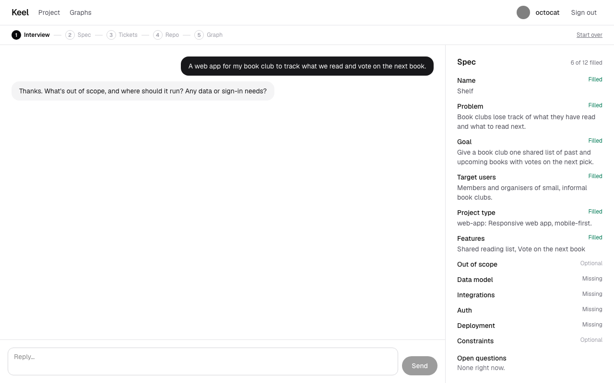
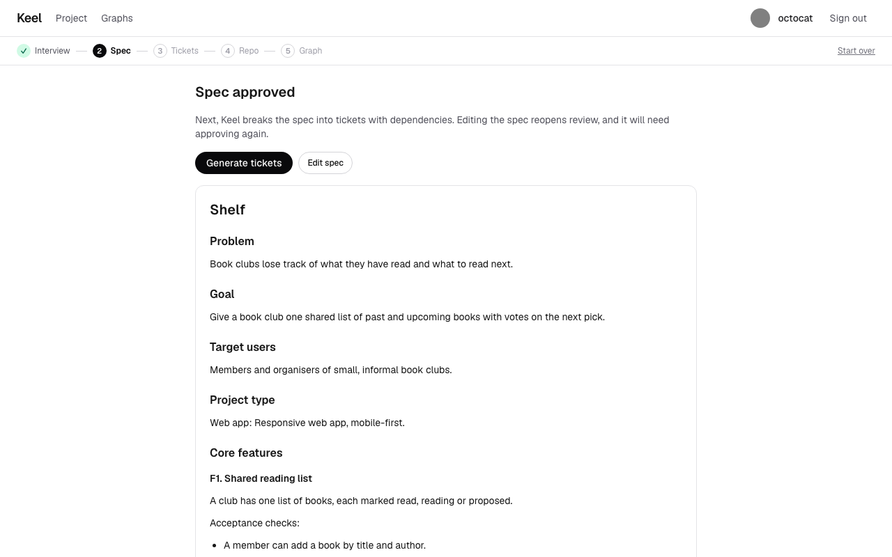
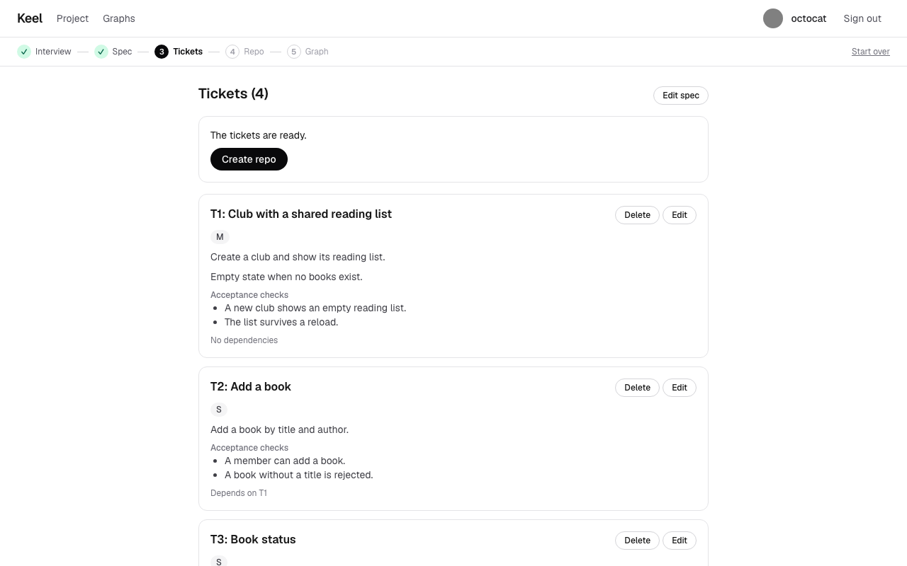
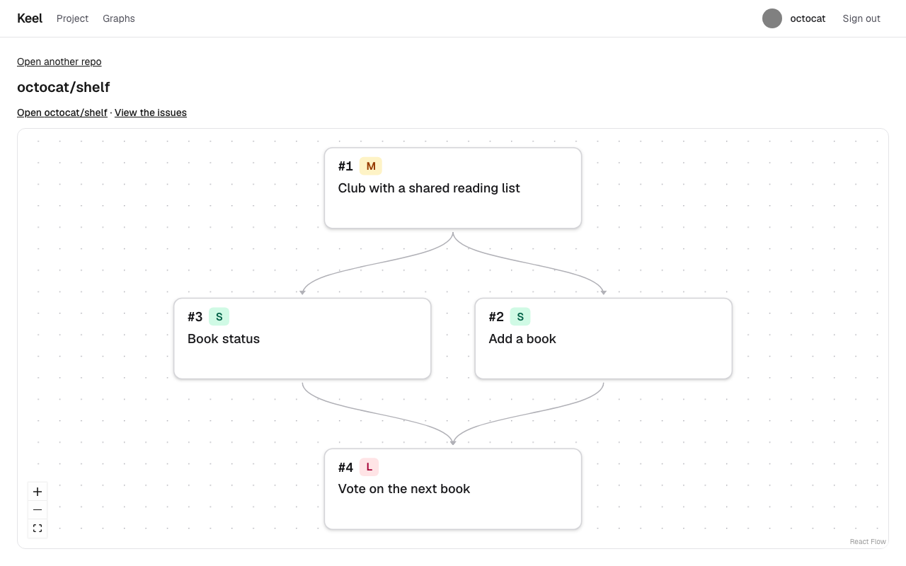

# Keel

Describe the software you want to build. Keel interviews you into a typed spec, breaks the approved spec into tickets with dependencies, and creates a GitHub repo with `SPEC.md`, the tickets as issues, and a dependency graph.

| Interview                                    | Approved spec                        |
| -------------------------------------------- | ------------------------------------ |
|  |    |
| **Tickets**                                  | **Dependency graph**                 |
|      |  |

## How it works

1. **Sign in with GitHub.** Access is limited to an allowlist, because the server spends the owner's Anthropic key.
2. **Interview.** Claude Sonnet asks questions and fills a fixed spec template through tool calls, which you watch fill in alongside the chat. The interview can only finish when the spec is complete.
3. **Review and approve.** You edit the spec section by section in a form, so it's valid at every step. What you approve is exactly what gets committed as `SPEC.md`.
4. **Tickets.** Claude Opus breaks the spec into tickets (one user-visible behaviour each, sized S/M/L) with dependencies, validated as a DAG. After you edit them, **Check impact** asks Opus what else should change, and you accept or reject each proposed change.
5. **Create.** Keel creates a public repo, commits `SPEC.md`, `docs/interview.md` and a README in one commit, adds labels, then creates the issues in dependency order with real `Depends on #N` lines. Creation is resumable: a retry never duplicates issues.
6. **Graph.** The dependency graph is read from the repo's issues, so it reflects edits made on GitHub. Open any repo's graph from **Graphs**.

There's no database. Until the repo exists, your project lives in this browser's localStorage; after that, GitHub is the source of truth.

## Architecture

```
Browser (React, localStorage)                      Next.js route handlers (stateless)
─────────────────────────────                      ─────────────────────────────────
Workspace reducer  ── POST /api/interview ───SSE──▶ interview tool loop ──▶ Anthropic (Sonnet)
  stages:          ── POST /api/tickets/generate ─▶ structured output   ──▶ Anthropic (Opus)
  interview →      ── POST /api/tickets/impact ───▶ proposal + DAG check ─▶ Anthropic (Opus)
  review →         ── POST /api/github/create ────▶ repo, commit, labels, ──▶ GitHub REST
  tickets →                                         issues (resumable)
  creating →       ── GET  /api/github/graph ─────▶ issues → graph      ──▶ GitHub REST
  created          ── /api/auth/* ────────────────▶ OAuth (PKCE) + sealed session cookie
```

- **Domain logic is pure and lives in `src/lib`**: spec schema, patches and completeness (`spec/`), ticket schema, DAG validation and topological sort (`tickets/`), prompts and tool definitions (`llm/`), GitHub operations (`github/`), and graph building and layout (`graph/`). Route handlers validate input, call `lib`, and stream typed events back.
- **Zod schemas are the single source of truth** for types, LLM tool inputs and structured outputs, request bodies, and the stored state.
- **The GitHub token stays on the server**, in an encrypted `iron-session` cookie. The OAuth scope is `public_repo` only.
- Every decision and the reasons for it are in [`docs/DECISIONS.md`](docs/DECISIONS.md); the build plan is in [`docs/PLAN.md`](docs/PLAN.md).

## Setup

Requires Node 26 and pnpm.

1. **Create a GitHub OAuth App** (GitHub → Settings → Developer settings → OAuth Apps):
   - Homepage URL: `http://localhost:3000`
   - Authorization callback URL: `http://localhost:3000/api/auth/callback`
2. **Create `.env.local`** from `.env.example`:

   | Variable                | What it is                                                                      |
   | ----------------------- | ------------------------------------------------------------------------------- |
   | `APP_URL`               | The app's absolute URL, e.g. `http://localhost:3000`                            |
   | `ANTHROPIC_API_KEY`     | Anthropic API key used for every LLM call                                       |
   | `GITHUB_CLIENT_ID`      | The OAuth App's client ID                                                       |
   | `GITHUB_CLIENT_SECRET`  | The OAuth App's client secret                                                   |
   | `SESSION_SECRET`        | At least 32 random characters, e.g. `openssl rand -base64 32`                   |
   | `ALLOWED_GITHUB_LOGINS` | Comma-separated GitHub logins allowed to sign in                                |
   | `KEEL_FAKE_EXTERNALS`   | Optional. `1` runs against in-process fakes (see below). Refused in production. |

   The server validates these at startup and lists any that are missing or invalid (names only, never values).

3. `pnpm install`, then `pnpm dev`.

### Fake mode

`KEEL_FAKE_EXTERNALS=1` runs the whole flow with no accounts and no API spend: Anthropic, the GitHub API and GitHub's OAuth endpoints are answered by in-process fakes, and sign-in approves at once as `octocat`. The real SDKs still run; they're handed a fetch that answers from the fakes and fails any request it has no fake for. The one thing still loaded from the network is the fake user's avatar image. Fake mode only works under `next dev`; production builds refuse it and don't include the fakes.

## Commands

```bash
pnpm dev           # local dev server
pnpm check         # lint + typecheck + unit and integration tests (run before every commit)
pnpm test:e2e      # Playwright smoke test of the full flow, in fake mode
pnpm screenshots   # regenerate the README screenshots, in fake mode
```

Unit and integration tests mock GitHub and Anthropic at the HTTP layer with MSW and never reach a real API. The first `pnpm test:e2e` needs `pnpm exec playwright install chromium`.

## Deploying to Vercel

1. Create a second GitHub OAuth App for production, with the callback `https://<your-domain>/api/auth/callback`.
2. Import the repo into Vercel and set every variable above for Production, with `APP_URL` set to the production URL. Leave `KEEL_FAKE_EXTERNALS` unset.
3. Deploy, then do one real run: sign in, finish an interview, generate tickets, create a throwaway repo and open its graph.

Every route stays within Vercel Hobby's 300s limit: long LLM calls stop themselves at 280s, and repo creation pauses at 270s and continues in a new request.

## Status

V0, built in phases (see [`docs/PLAN.md`](docs/PLAN.md)). Out of scope for now: running Claude on the tickets, GitHub Actions, a kanban board, starter templates, and bringing your own API key.
